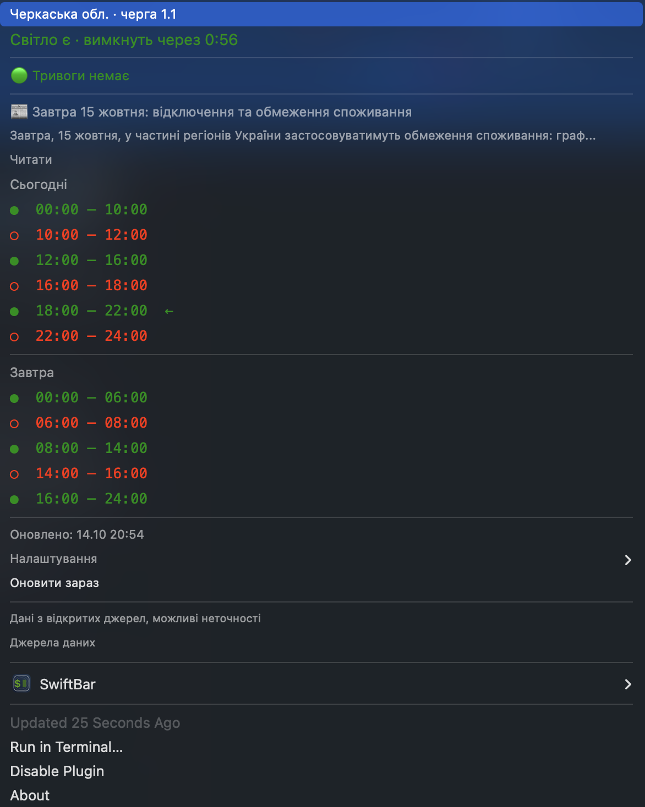

# Blackout

Графік відключень світла і повітряні тривоги в menu bar macOS. Скільки лишилось до вимкнення, коли дадуть, яка загроза — без відкривання телеграму.

<p align="center">
  
</p>

```
💡 5:37      світло є, вимкнуть через 5 год 37 хв
💡           світло є, відключень більше не заплановано
🕯️ 1:30      світла немає, дадуть через 1 год 30 хв
🚨           аварійні відключення — графік не діє
❔           графіка на сьогодні немає
📅 11.04     джерело давно не оновлювалось
```

Префікс тривоги ліворуч, рівень = тип загрози:

```
🟡 💡 5:37   жовтий рівень — дрони
🔴 🕯️ 1:30   червоний рівень — ракети, масований удар
```

Суфікс `⏳` — до зміни менше 15 хвилин.

Клік відкриває розклад на сьогодні й завтра, стан тривоги, новину енергосистеми та налаштування.

<p align="center">
  
</p>

> Дані з відкритих джерел. Графік — це план, а не гарантія: [детальніше](#застереження).

---

## Встановлення

```sh
brew install --cask swiftbar
git clone --branch v1.0.2 https://github.com/olegarutin/blackout.git ~/blackout
chmod +x ~/blackout/plugin/blackout.1m.rb
open -a SwiftBar
```

При першому запуску SwiftBar спитає папку з плагінами — вкажи **`~/blackout/plugin`**.

> Саме `plugin`, а не `~/blackout`. SwiftBar намагається виконати **кожен** файл у своїй папці, тож README й LICENSE поруч із плагіном дадуть зайвий значок із помилкою.

Більше нічого не треба: Ruby вже є в macOS, зовнішніх гемів немає.

<details>
<summary>Якщо Ruby не знайдено</summary>

Скрипт працює на Ruby 2.6 і новіших, тобто на штатному інтерпретаторі macOS. Apple позначила його застарілим і колись прибере — тоді:

```sh
brew install ruby
```

Якщо користуєшся `rbenv` чи `rvm`, скрипт сам візьме твою версію: у ньому `#!/usr/bin/env ruby`, без прив'язки до шляху.
</details>

При першому запуску в menu bar з'явиться `🔌` і прохання вибрати область. Застосунок нічого не вгадує й до вибору в мережу не ходить — вибери область, у ній натисни свою чергу, і далі він працює сам.

Не знаєш свою чергу — у кожній області є пункт **«Не знаю свою чергу»**, що веде на сайт її обленерго з пошуком за адресою.

**Сповіщення.** Перший банер macOS покаже не зразу: системі потрібен дозвіл для SwiftBar. Якщо банерів немає — **Системні налаштування → Повідомлення → SwiftBar**. Сам графік у menu bar від цього не залежить.

**Оновлення.**

```sh
cd ~/blackout && git fetch --tags
git checkout "$(git tag -l 'v*' --sort=-v:refname | head -1)"
```

Перейде на найсвіжіший випуск, хоч би який він був. SwiftBar підхопить новий файл сам, перезапускати не треба. Перелік версій — у [релізах](https://github.com/olegarutin/blackout/releases); `git checkout main && git pull` дає свіжу розробку, якщо хочеться жити на краю.

**Часовий пояс.** Графік — це київські години, тож застосунок рахує час за Києвом незалежно від поясу мака. Відлік «через 2:15» від цього не залежить, а години в розкладі (`16:00 – 19:00`) — київські. Для когось за кордоном це те, що й потрібно: видно, коли світло вдома, а не в тебе.

---

## Що вміє

**Відлік до зміни.** Не «о 16:00», а «через 2:15» — те, що насправді цікавить.

**Повітряна тривога** з типом загрози. Україна має дворівневу систему: жовтий оголошують під час атаки дронів, червоний — при ракетній загрозі та масованих ударах. Застосунок показує рівень іконкою, тривалість і перелік районів.

Тривоги часто оголошують **лише по окремих районах**, і прапорець області при цьому лишається вимкненим. Застосунок враховує обидва випадки.

У налаштуваннях можна **обрати свій район** — тоді тривога в сусідньому не чіпатиме. Оголошення на всю область лишається значущим у будь-якому разі.

**Новини енергосистеми.** Головне повідомлення Укренерго — графік каже «коли», а воно пояснює «чому»: атака, дефіцит, ремонт. Інколи там прохання обмежити споживання у конкретні години, чого в графіку немає взагалі.

**Аварійні відключення.** Коли енергосистема переходить на аварійні, графіки перестають діяти — відключають поза ними. Застосунок бере рівень обмежень по області з `alerts.energy` і при аварійних показує `🚨`, ховаючи відлік: показувати час за графіком, який не діє, було б брехнею.

**Сповіщення.** За 15 хвилин до зміни (5/10/15/30/60 на вибір), коли графік на сьогодні переписали, і коли живлення розійшлося з графіком.

**Робота без мережі.** Дані кешуються. Коли світло зникло і роутер мовчить, застосунок покаже останній відомий графік — саме тоді він і потрібен.

**Ощадливий до трафіку.** Запити умовні: якщо дані не змінились, сервер відповідає `304 Not Modified` без тіла. Це критично для Києва, де файл графіків важить 300 КБ — без цього виходило б близько 475 МБ на добу.

| | Запитів на добу | Трафік, Черкаси | Трафік, Київ |
|---|---|---|---|
| Без умовних запитів | 2880 | ≈ 43 МБ | ≈ 475 МБ |
| Як зараз | ≈ 1900 | кілька МБ | кілька МБ |

Графік перевіряється раз на 170 секунд (джерело оновлюється раз на 5 хвилин), тривоги — щохвилини, бо важливіші за часом. Відлік у menu bar перераховується щохвилини з кешу, без мережі.

---

## Покриття

**Вибрати можна 26 регіонів** — 24 області, АР Крим і Київ, тобто все, що покриває `alerts.energy`. Але графік насправді є далеко не в усіх. Станом на 15 жовтня 2026:

| Що показує застосунок | Регіонів |
|---|---|
| робочий графік із відліком | 9 |
| `🚨` аварійні — графік не діє | 1 |
| `❔` даних немає | 10 |
| `📅` дані застарілі на місяці | 6 |

Тобто **корисну відповідь дає приблизно кожен третій регіон**, і це межа джерел, а не застосунку. Де графіка немає, він каже про це прямо (`❔`, `📅`) і далі показує тривоги та новини — вони працюють усюди. Коли область починає публікувати, вона запрацює сама, без оновлення застосунку.

Севастополя в переліку немає: він є в джерелі тривог, але графіків для нього ніхто не публікує.

Перевірити самому: обери будь-яку область у налаштуваннях і подивись, що з'явиться.

**Основне джерело — `alerts.energy`.** Воно моніторить сайти обленерго й ДТЕК і віддає графіки з **явними статусами** замість здогадок:

```
ScheduleApplies      графік діє
NoShutdowns          відключень немає
EmergencyShutdowns   аварійні, графік не діє
WaitingForSchedule   на завтра ще не опублікували
```

Дані перевіряються кожні кілька хвилин, є окреме поле для «можливо відключення».

**Запасне — GitHub-репозиторії** `OE_OUTAGE_DATA` і `outage-data-ua`. Вмикаються, коли основне джерело мовчить. Шість із дванадцяти обленерго там стоять із липня, тож покладатись на них самих було б помилкою.

**Застарілі дані показуються застарілими** — іконкою `📅` і датою. Застосунок не вдає, ніби квітневий графік актуальний: мовчазна впевненість у неправильних даних гірша за відверте «не знаю».

---

## Безпека

Застосунок виконується щохвилини й читає дані з інтернету, тому межі окреслені явно.

**Мережа.** Два `GET` на `raw.githubusercontent.com` і один на `vadimklimenko.com`. Усе — статичні JSON без авторизації. Жодних токенів, жодної телеметрії, нічого не надсилається назовні.

**Запис на диск.** Лише `~/.config/blackout.json` і `~/.cache/blackout/`. Нічого поза ними.

**Запис не йде за символьними посиланнями.** Будь-яка програма, запущена від твого імені, може підкласти в кеш посилання на чужий файл. Звичайний `File.write` пішов би за ним і перезаписав ціль даними з мережі. Тому запис іде через тимчасовий файл і перейменування: воно замінює саме посилання, а не те, на що воно вказує. Заразом це робить запис атомарним — паралельні запуски не лишають обрізаного кешу. Тека кешу створюється з правами `0700`, файли — `0600`.

Тека кешу не може бути посиланням: інакше ми писали б свої файли в чужу теку й могли замінити те, що там уже лежить під нашими назвами.

**Дані з мережі ніколи не потрапляють у виконувані контексти.** SwiftBar розділяє текст і параметри символом `|`, а самі параметри — пробілами. Параметр `bash=` виконує команди, тож обидва розділювачі небезпечні:

- текст із мережі проходить через `safe()`, яка вирізає `|`
- значення, що йдуть у параметри (наприклад `href=`), додатково перевіряються суворим шаблоном `[\w.~-]{1,120}` — усе інше просто не виводиться

Другої перевірки спершу не було, і підсунутий `slug` новини з пробілом міг стати окремим параметром `bash=`. Знайдено власним тестом, закрито, є регресійний тест.

**Кеш перевіряється при читанні, а не лише при записі.** Спершу схема перевірялась тільки на вході з мережі, а з кешу дані брались як є. Назва черги звідти йде у значення параметра пункту меню, тож підмінений кеш міг додати до пункту власний `bash=`. Тепер і графік, і рядки `alerts.energy` перевіряються на кожному читанні, а назва черги додатково фільтрується шаблоном перед виводом.

**ETag теж приходить із файлу.** Його значення йде в заголовок `If-None-Match`. Ruby сам відкидає `CR`/`LF`, але мегабайтне значення з підмінного файлу відправив би як є — тому приймається лише друкований ASCII до 200 символів.

**Регіон і черга валідуються.** Регіон стає частиною URL і шляху до кешу, тому приймаються лише ключі зі списку; черга — лише за шаблоном `GPV\d{1,3}\.\d{1,2}`. Це закриває і обхід шляху, і ін'єкцію в меню через конфіг.

**Сповіщення.** `osascript` викликається масивом аргументів, без оболонки; текст екранується від лапок, зворотної коси й переносів рядка.

**Виконання команд.** Рівно одне місце: `osascript` для банера, викликаний масивом аргументів. Дані з мережі туди не потрапляють взагалі — лише номер черги (перевірений шаблоном) і числа.

**Обмеження розміру.** Будь-який текст із мережі обрізається до 200 символів, переліки — до розумної кількості. Без цього заголовок новини на 100 КБ розтягнув би пункт меню на весь екран.

Відповідь читається потоково з межею 2 МБ: межа спрацьовує **під час** читання, а не після. Інакше скомпрометоване джерело могло б віддати гігабайт, і ми б набрали його в пам'ять цілком, перш ніж обуритись.

**Редиректи не виконуються.** `Net::HTTP` сам за ними не йде, і це залишено як є: інакше джерело могло б перекинути запит на `http://` чи на внутрішню адресу. Схема перевіряється явно — лише `https`.

---

## Тести

```sh
ruby test/test_blackout.rb
```

98 тестів, без зовнішніх залежностей. Два рівні:

**Чисті функції** — санітизація, валідація схеми, розбір годин, відлік до зміни. Витягуються з вихідника й перевіряються напряму.

**Інтеграційні** — скрипт запускається окремим процесом із тимчасовим `HOME` і підготованим кешем, тож у мережу не ходить і не чіпає справжні налаштування.

Окремо перевіряється, що відповідь однакова у п'яти часових поясах і що перший запуск не вдає чужу область своєю.

Окремо перевіряються спроби атак: ін'єкція через чергу з конфігу й через отруєний кеш, обхід шляху через регіон, назва району з мережі як параметр меню, підкладене символьне посилання на файл і на теку кешу, роздутий і зіпсований ETag, невідома схема в кеші, пошкоджений кеш, зіпсована дата.

---

## Налаштування

У меню, під пунктом **Налаштування**:

- регіон і черга
- показувати повітряну тривогу
- сповіщення та за скільки хвилин попереджати

Зберігається в `~/.config/blackout.json`, кеш у `~/.cache/blackout/`.

Частота оновлення — з назви файлу: `blackout.1m.rb` раз на хвилину. Перейменуй на `.5m.rb`, якщо хочеш рідше.

---

## Джерела

| Що | Звідки |
|---|---|
| Графіки, 12 обленерго | [yaroslav2901/OE_OUTAGE_DATA](https://github.com/yaroslav2901/OE_OUTAGE_DATA) |
| Графіки, Київ / Дніпро / Одеса | [Baskerville42/outage-data-ua](https://github.com/Baskerville42/outage-data-ua) |
| Повітряні тривоги | [vadimklimenko.com](https://vadimklimenko.com/map/statuses.json) |
| Рівень обмежень, аварійні | [alerts.energy](https://alerts.energy/) |
| Новини енергосистеми | [alerts.energy](https://alerts.energy/) |
| Семантика рівнів тривоги | [alerts.in.ua](https://blog.alerts.in.ua/p/alert-levels) |
| Оболонка menu bar | [SwiftBar](https://github.com/swiftbar/SwiftBar) |

Обидва репозиторії з графіками оновлюються автоматично кожні 5 хвилин. Застосунок читає статичні JSON — нічиєї верстки не парсить, тому не ламається від редизайну сайтів.

---

## Чого не вміє

**Розрізнити балістику й крилаті ракети.** Червоний рівень означає «ракетна загроза або масований удар». Точніший тип оголошують текстом у телеграм-каналах; жоден відкритий структурований API цього не віддає.

**Сказати, коли дадуть світло під час аварійних.** Цього не знає ніхто, зокрема й оператор. Застосунок чесно показує `🚨` і ховає відлік замість вигадувати число.

**Регіони поза списком.** Кожне обленерго публікує по-своєму — хтось JSON, хтось PDF, хтось картинки. Це 24 різні парсери, а не один.

**Показати години у твоєму поясі.** Розклад завжди київський. Відлік до зміни однаковий у будь-якому поясі, а ось `16:00 – 19:00` означає Київ.

---

## Застереження

Застосунок **показує чужі дані, а не свої**. Він читає те, що публікують оператори через `alerts.energy` і відкриті репозиторії, і не перевіряє, чи це правда.

Графік — це **план, а не гарантія**. Реальність відрізняється через аварійні відключення, погоду, пошкодження мережі й рішення, які ухвалюють швидше, ніж встигають опублікувати.

Тому:

- **не плануй критичного за цим застосунком** — медичне обладнання, операції, усе, де ціна помилки висока
- коли дані застарілі або їх немає, він каже про це прямо (`📅`, `❔`) — це не косметика, а попередження
- під час аварійних відключень відлік ховається навмисно: ніхто, зокрема оператор, не знає, коли дадуть світло

Для щоденного «коли вимкнуть, чи встигну запустити пралку» — цілком годиться. Саме для цього й робився.

Програма надається як є, без жодних гарантій (див. [LICENSE](LICENSE)).

---

## Ліцензія

MIT
